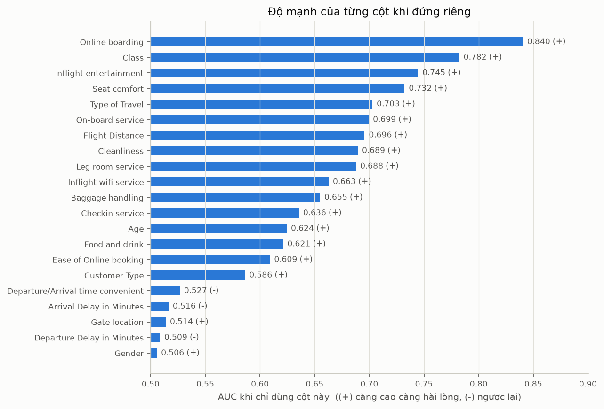
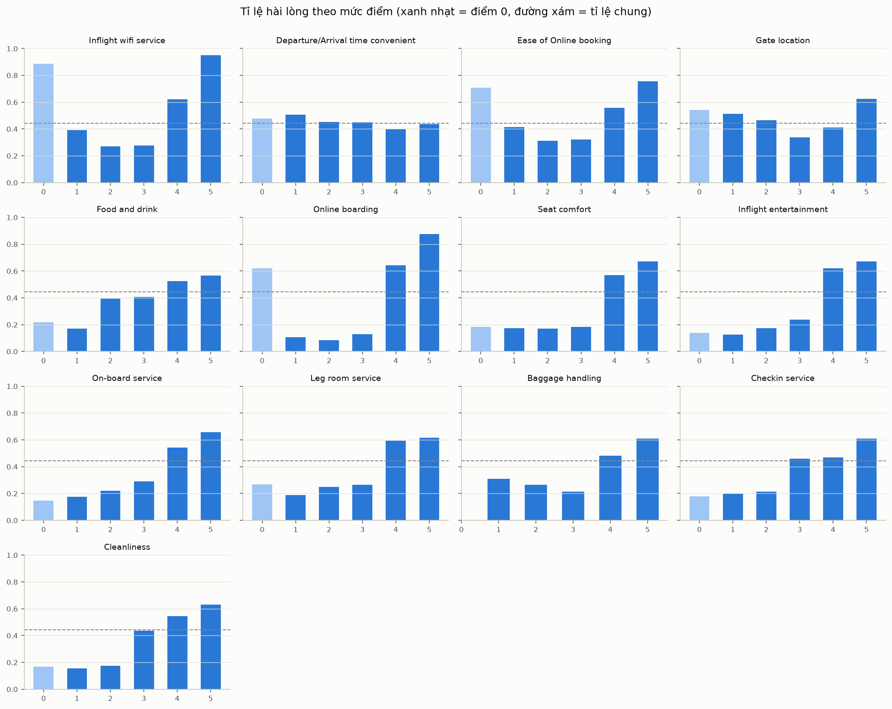
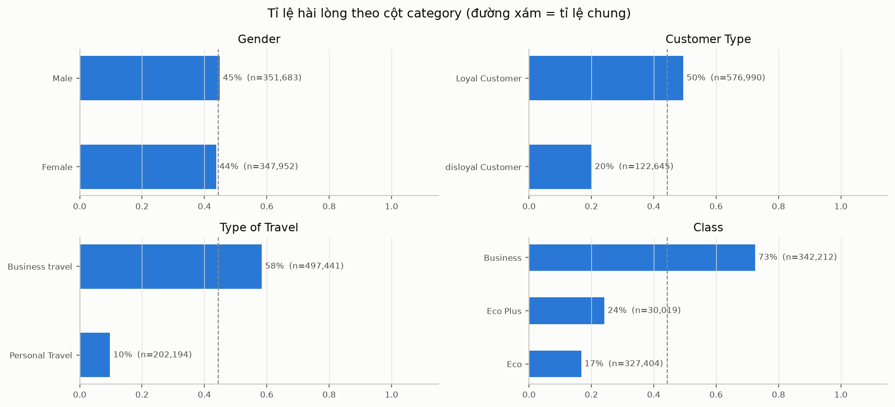
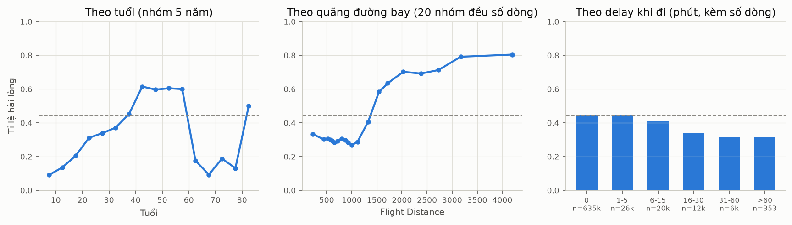
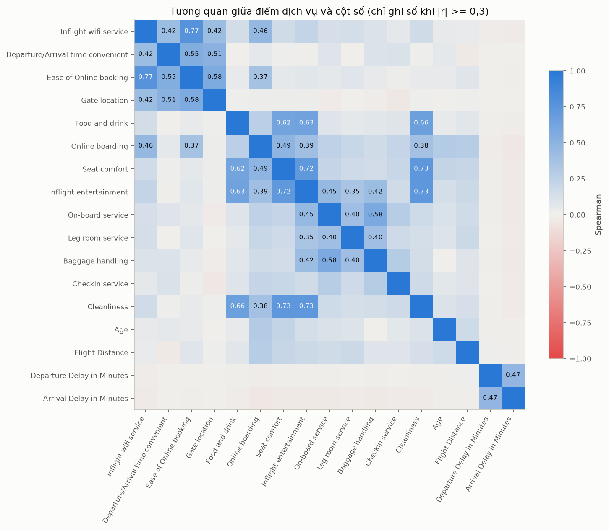

# Tóm tắt EDA (A, 13/10/2026)

Code và toàn bộ biểu đồ: [notebooks/A_eda.ipynb](../notebooks/A_eda.ipynb). Hình lưu ở [reports/figures/](figures/).

Trong file này, "AUC một cột" là AUC khi chỉ dùng riêng cột đó để dự đoán: 0,5 là vô dụng, càng gần 1 càng mạnh.

## 0. Dữ liệu có gì

Mỗi dòng là một hành khách sau một chuyến bay. Train có 699.635 dòng, test có 299.844 dòng. Nghĩa của các cột lấy theo mô tả của bộ dữ liệu gốc.

**Target:** `satisfaction` = True nếu hành khách hài lòng (44,36%), False nếu trung lập hoặc không hài lòng. `load_data()` đổi sang 1/0.

**Thông tin hành khách và chuyến bay**

| Cột | Ý nghĩa | Giá trị |
| --- | --- | --- |
| `Gender` | Giới tính | Male / Female |
| `Customer Type` | Khách thân thiết của hãng hay không | Loyal Customer / disloyal Customer |
| `Age` | Tuổi | 7-85 |
| `Type of Travel` | Mục đích chuyến bay | Business travel (công tác) / Personal Travel (việc riêng) |
| `Class` | Hạng ghế | Business / Eco (phổ thông) / Eco Plus (phổ thông đặc biệt) |
| `Flight Distance` | Quãng đường bay (bộ gốc không ghi đơn vị) | 67-4.983 |
| `Departure Delay in Minutes` | Số phút cất cánh trễ | 0-489, 91% bằng 0 |
| `Arrival Delay in Minutes` | Số phút hạ cánh trễ | 0-491, thiếu ở 292 dòng train và 130 dòng test |

**13 cột điểm đánh giá dịch vụ**, hành khách tự chấm từ 1 (tệ) đến 5 (tốt). Theo mô tả bộ gốc, **0 nghĩa là không áp dụng hoặc không đánh giá**.

| Cột | Đánh giá điều gì |
| --- | --- |
| `Inflight wifi service` | Wifi trên máy bay |
| `Departure/Arrival time convenient` | Giờ cất cánh và hạ cánh có thuận tiện không |
| `Ease of Online booking` | Đặt vé online có dễ không |
| `Gate location` | Vị trí cổng ra máy bay |
| `Food and drink` | Đồ ăn, thức uống |
| `Online boarding` | Làm thủ tục lên máy bay online |
| `Seat comfort` | Độ thoải mái của ghế |
| `Inflight entertainment` | Giải trí trên máy bay (phim, nhạc) |
| `On-board service` | Phục vụ của tiếp viên trên máy bay |
| `Leg room service` | Chỗ để chân |
| `Baggage handling` | Xử lý hành lý (cột này không có điểm 0) |
| `Checkin service` | Thủ tục check-in tại quầy |
| `Cleanliness` | Độ sạch sẽ |

`id` chỉ là số thứ tự dòng, không mang thông tin (đã kiểm tra: không liên quan đến target).

Mục 1 của notebook có thêm `head()`, bảng kiểu dữ liệu, `describe()` và so sánh trung bình train với test. Trung bình của tuổi, quãng đường và các cột điểm ở hai bên chênh nhau dưới 0,2%. Hai cột delay chênh khoảng 1-2%, chỉ vì trung bình của chúng rất nhỏ (khoảng 1,1 phút).

## 1. Train và test giống nhau, cứ tin CV

Adversarial validation (LightGBM phân biệt dòng train với dòng test) cho **AUC = 0,4995**, tức là hoàn toàn không phân biệt được. Không có cột nào bị lệch phân phối, nên điểm CV sẽ phản ánh đúng điểm trên test.

## 2. Cột mạnh và cột yếu

- **Mạnh nhất:**
  - `Online boarding` (0,84)
  - `Class` (0,78)
  - `Inflight entertainment` (0,745)
  - `Seat comfort` (0,73)
  - `Type of Travel` (0,70)
- **Gần như vô dụng khi đứng riêng:**
  - `Gender` (0,506)
  - Hai cột delay (khoảng 0,51)
  - `Gate location` (0,514)
  - `Departure/Arrival time convenient` (0,527)

  Đừng bỏ vội các cột này. Muốn bỏ thì kiểm tra bằng CV.

## 3. Điểm dịch vụ: điểm 0 rất đặc biệt, và không tăng đều

- **Điểm 0 ở vài cột cho tỉ lệ hài lòng rất cao:**

  | Cột | Tỉ lệ hài lòng khi điểm 0 | Số dòng |
  | --- | --- | --- |
  | `Inflight wifi service` | **89%** | 13 nghìn |
  | `Ease of Online booking` | 71% | 16 nghìn |
  | `Online boarding` | 62% | 9 nghìn |

  Tỉ lệ chung chỉ 44%. Vậy điểm 0 không phải "điểm thấp nhất", mà là một nhóm riêng.
- **Hình chữ U:** `Inflight wifi service`, `Ease of Online booking`, `Gate location`, `Baggage handling` có tỉ lệ hài lòng ở điểm 1 cao hơn ở điểm 2-3, rồi mới tăng lại ở điểm 4-5.
- **Bước nhảy giữa điểm 3 và 4:** `Seat comfort`, `Inflight entertainment`, `Leg room service`, `Online boarding` gần như phẳng từ 0 đến 3, rồi nhảy vọt ở điểm 4. Ví dụ `Online boarding` từ 13% lên 64%.
- `Departure/Arrival time convenient` gần như không đổi theo điểm, và hơi ngược chiều (điểm cao thì tỉ lệ hài lòng hơi thấp hơn).

## 4. Tương tác giữa các cột category

| | Business travel | Personal Travel |
| --- | --- | --- |
| Business | **73%** | 11% |
| Eco | 26% | 10% |
| Eco Plus | 35% | 10% |

- **Khách đi việc riêng (Personal Travel) gần như không hài lòng (khoảng 10%), bất kể hạng ghế.** Hạng ghế chỉ tạo khác biệt với khách đi công tác.
- Khách không thân thiết (disloyal) khoảng 20%. Riêng disloyal đi Eco Plus chỉ 6,4% (2.577 dòng).
- Gần như toàn bộ khách disloyal là đi công tác (122.540 / 122.645 dòng).

## 5. Cột số

- **Tuổi không tăng đều:**
  - Dưới 20 tuổi chỉ 10-20% hài lòng.
  - 40-60 tuổi khoảng 60%.
  - **Trên 60 tuổi tụt mạnh còn 10-20%.**
  - Điểm nhô lên ở nhóm 80+ không đáng tin vì chỉ có 40 dòng.
- **Quãng đường bay:** dưới khoảng 1.100 thì khoảng 30%, rồi tăng vọt lên 60-80% từ khoảng 1.500 trở đi. Cột này có thể đang phản ánh hạng ghế và mục đích chuyến đi.
- **Delay:**
  - 91% chuyến không trễ.
  - Trễ càng lâu càng ít hài lòng: 45% khi không trễ, 31% khi trễ trên 30 phút.
  - Vì rất ít chuyến bị trễ nên AUC của cột này thấp.
  - Delay đi và delay đến chỉ tương quan 0,47 (Spearman).
  - 87% số dòng có hai cột delay bằng nhau.
- **292 dòng thiếu `Arrival Delay`:**
  - Tỉ lệ hài lòng 36%, thấp hơn mức chung.
  - Delay đi trung bình 7,4 phút, so với khoảng 1,2 phút ở toàn bộ train.
  - Vậy việc thiếu không ngẫu nhiên.

## 6. Nhóm cột đi cùng nhau

| Nhóm | Cột | Tương quan Spearman |
| --- | --- | --- |
| Trước chuyến bay, online | `Inflight wifi service`, `Ease of Online booking`, `Gate location`, `Departure/Arrival time convenient` | 0,42-0,77 |
| Tiện nghi trên máy bay | `Food and drink`, `Seat comfort`, `Inflight entertainment`, `Cleanliness` | 0,62-0,73 |
| Phục vụ | `On-board service`, `Leg room service`, `Baggage handling` | 0,40-0,58 |

`Age`, `Flight Distance` và delay gần như không tương quan với các điểm dịch vụ.

## 7. Gợi ý cho B (feature engineering, nhiệm vụ #11)

Tất cả đều là ý tưởng cần thử bằng CV, chưa chắc có ích với GBDT vì GBDT tự học được nhiều tương tác.

1. **Cờ điểm 0** cho mỗi cột điểm, cộng thêm **số cột có điểm 0**.
2. **Cờ điểm ≥ 4** cho mỗi cột, cộng thêm **số cột có điểm ≥ 4**.
3. **Trung bình, min, max theo 3 nhóm cột** ở mục 6. Nên bỏ điểm 0 khi tính.
4. **Cột ghép:** `Class × Type of Travel`, `Customer Type × Class`, `Customer Type × Type of Travel`.
5. **Tuổi chia nhóm** (dưới 20, 20-39, 40-60, trên 60), hoặc để GBDT tự xử lý.
6. **Delay:** `log1p`, cờ "có trễ", chênh lệch `Arrival - Departure`, cờ thiếu `Arrival Delay`.
7. **Thử coi các cột điểm là category** thay vì số.

## 8. Gợi ý cho C (MLP, logistic)

- Model tuyến tính và MLP không tự bắt được hình chữ U và bước nhảy ở điểm 4. Nên **one-hot các cột điểm**, hoặc ít nhất thêm cờ điểm 0 và cờ điểm ≥ 4. Logistic hiện coi điểm là số nên CV mới đạt 0,9216, nhiều khả năng còn tăng được.
- Thêm cột ghép `Class × Type of Travel`.
- Tuổi và quãng đường nên chia nhóm, hoặc dùng spline.
- `Arrival Delay` thiếu: điền bằng `Departure Delay`, kèm cờ thiếu.

## 9. Chưa làm

- So sánh với dữ liệu gốc 129k (nhiệm vụ #9, từ 17/10).
- Xem feature importance của LightGBM khi B có baseline, rồi đối chiếu với bảng AUC một cột.
